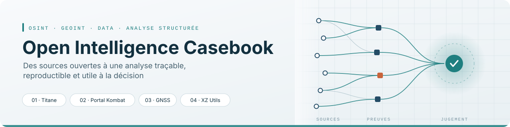
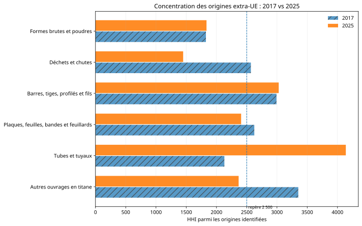
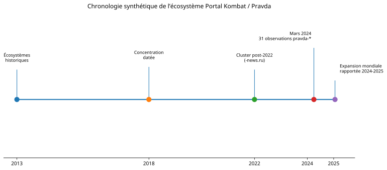
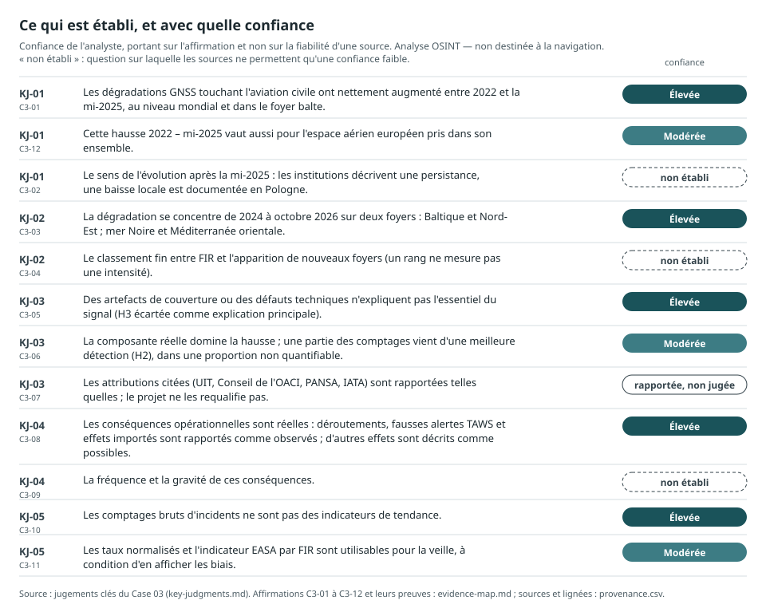

<div align="center">

<picture>
  <source media="(prefers-color-scheme: dark)" srcset="assets/banner-dark.svg">
  
</picture>

# 🧭 Open Intelligence Casebook

### Des sources ouvertes à une analyse traçable, reproductible et utile à la décision

[](README.md)
[](#les-casebooks)
[](#m%C3%A9thode-commune)
[](publication/release-checklist.md)

**Open Intelligence Casebook** est un portfolio public d'études d'intelligence en sources ouvertes.  
Chaque cas part d'une question concrète, transforme des sources publiques en preuves vérifiables, confronte plusieurs hypothèses et restitue un jugement avec ses limites.

[📘 Case 01 — Titane](cases/case-01-titanium/README.md) · [📕 PDF](cases/case-01-titanium/report.pdf) · [🛰️ Case 02 — Portal Kombat](cases/case-02-portal-kombat/README.md) · [📕 PDF](cases/case-02-portal-kombat/report.pdf) · [🛩️ Case 03 — GNSS](cases/case-03-gnss-interference/README.md) · [🔐 Case 04 — XZ Utils](cases/case-04-xz-utils/README.md)

</div>

---

## En un coup d'œil

| | |
|---|---|
| **4 études finalisées et publiées** | Chaque cas en Markdown et en PDF A4 reconstruit par la CI |
| **4 casebooks** | 4 publiés · GNSS finalisé dans son périmètre documentaire |
| **Approche** | OSINT passif · GEOINT · analyse de données · graphes · ACH |
| **Principe central** | **Decision-first + Evidence-deep** : décision rapide, preuve entièrement auditable |

> **Ce dépôt n'est pas un dump de recherche.** C'est une édition publique assainie : pas d'historique privé, pas d'audits internes, pas de secrets et pas de corpus tiers redistribué lorsque les droits sont incertains.

### Par où commencer ?

**Première visite : [lire le guide de découverte](READING_GUIDE.md) · [télécharger le guide PDF](READING_GUIDE.pdf).** Il explique le renseignement, les mots techniques, l'état des cas et le prochain sujet proposé.

« Finalisé » décrit une édition et un périmètre. Des inconnues peuvent rester ouvertes. Le 13 novembre 2026, les quatre études ont une édition finale ; GNSS reste documentaire, sans analyse de trajectoires ADS-B/GPSJAM. Cette clarification éditoriale ne constitue pas une actualisation des sources.


| Vous avez… | Lisez | Vous obtenez |
|---|---|---|
| **5 minutes** | la section « En deux minutes » d'un README de cas | la question, la réponse et le niveau de confiance |
| **30 minutes** | le rapport complet ([Case 01](cases/case-01-titanium/report.md) · [Case 02](cases/case-02-portal-kombat/report.md) · [Case 03](cases/case-03-gnss-interference/report.md) · [Case 04](cases/case-04-xz-utils/report.md)) | le raisonnement, les hypothèses concurrentes et les limites |
| **le temps d'auditer** | la carte des preuves, la table de provenance et les métriques dérivées | le lien vérifiable entre chaque affirmation publique et sa source |

---

## Les casebooks

### ✈️ Case 01 — Titane & résilience aéronautique

**Question :** comment la dépendance européenne aux importations de titane a-t-elle évolué depuis 2014, et quelles preuves supplémentaires faut-il avant d'en déduire la résilience aéronautique à l'horizon 2030 ?

L'étude combine données commerciales publiques, preuves industrielles et analyse structurée. Elle montre surtout qu'une diversification commerciale ne devient pas automatiquement une alternative aéronautique utilisable.

**À retenir :**
- six catégories CN8 étudiées séparément ;
- comparaison commune des origines entre **2017 et 2025** ;
- concentration très hétérogène selon les formes ;
- distinction stricte entre **capacité → qualification → approbation client → accès contractuel → livraison → substitution** ;
- trois scénarios qualitatifs à l'horizon 2030 et un portefeuille d'options conditionnelles.

<p align="center">
  
</p>

<div align="center">

[**Lire la synthèse**](cases/case-01-titanium/README.md) · [**Rapport complet en Markdown**](cases/case-01-titanium/report.md) · [**Télécharger le rapport PDF**](cases/case-01-titanium/report.pdf) · [**Méthodologie**](cases/case-01-titanium/methodology.md) · [**Sources**](cases/case-01-titanium/sources.md) · [**Carte des preuves**](cases/case-01-titanium/evidence-map.md) · [**Provenance**](cases/case-01-titanium/provenance.csv)

</div>

---

### 🛰️ Case 02 — Portal Kombat / Pravda

**Question :** que peut-on établir, à partir de sources publiques figées, sur l'expansion, la structure, la localisation et la visibilité de l'écosystème Portal Kombat / Pravda — et que reste-t-il non démontré sur sa coordination et son impact ?

Le cas associe chronologie, analyse de graphe STIX, tests de sensibilité, dissémination Wikipedia/X, triangulation multi-sources et hypothèses concurrentes.

**À retenir :**
- **371 observations correspondant à 370 domaines distincts** dans le snapshot VIGINUM utilisé ;
- **609 nœuds** et **1 013 relations** dans le paquet STIX analysé ;
- **1 932** observations Wikipedia réparties entre **44 éditions linguistiques** et **2 018** observations X dans les données de dissémination étudiées ;
- une lecture **hybride** reste l'hypothèse de travail la plus compatible avec le corpus, sans constituer une attribution ;
- le rapport sépare explicitement **visibilité, coordination, attribution et impact**.

<p align="center">
  
</p>

<div align="center">

[**Lire la synthèse**](cases/case-02-portal-kombat/README.md) · [**Rapport complet en Markdown**](cases/case-02-portal-kombat/report.md) · [**Télécharger le rapport PDF**](cases/case-02-portal-kombat/report.pdf) · [**Méthodologie**](cases/case-02-portal-kombat/methodology.md) · [**Sources**](cases/case-02-portal-kombat/sources.md) · [**Carte des preuves**](cases/case-02-portal-kombat/evidence-map.md) · [**Provenance**](cases/case-02-portal-kombat/provenance.csv)

</div>

---

### 🛩️ Case 03 — Interférences GNSS & aviation civile européenne

**Statut : évaluation documentaire finale (version 1.0 du 1er novembre 2026).**

**Question :** comment les données ouvertes peuvent-elles aider à suivre et caractériser les dégradations de navigation touchant l'aviation civile européenne depuis 2022, sans confondre corrélation, couverture des capteurs et causalité ?

Le cas confronte huit sources institutionnelles et sectorielles (EASA, OACI, IATA, atelier EASA–EUROCONTROL, UIT), regroupées en dix lignées d'information, à quatre hypothèses concurrentes. La couche d'observation propre (ADS-B, GPSJAM) prévue au départ n'a pas été exécutée : aucune trajectoire, aucun identifiant d'aéronef et aucune donnée GPSJAM n'est publié.

**À retenir :**
- **hausse nette** des dégradations GNSS de 2022 à la mi-2025 ; évolution ultérieure **non établie** ;
- **deux foyers persistants** : Baltique et Nord-Est ; mer Noire et Méditerranée orientale ;
- des **brouillages et leurrages réels**, amplifiés par une meilleure détection ; l'hypothèse « simples artefacts » est écartée comme explication principale ;
- des **conséquences opérationnelles documentées**, dont la fréquence n'est pas mesurable ;
- pour la veille, des **taux normalisés**, jamais des comptages bruts : à Budapest, seuls 2,6 à 8,1 % des événements détectés sont déclarés par les pilotes ;
- les attributions citées (UIT, Conseil de l'OACI, PANSA, IATA) sont **rapportées**, jamais requalifiées par le projet.

<p align="center">
  
</p>

<div align="center">

[**Lire la synthèse**](cases/case-03-gnss-interference/README.md) · [**Rapport complet en Markdown**](cases/case-03-gnss-interference/report.md) · [**Télécharger le rapport PDF**](cases/case-03-gnss-interference/report.pdf) · [**Jugements clés**](cases/case-03-gnss-interference/key-judgments.md) · [**Sources**](cases/case-03-gnss-interference/sources.md) · [**Carte des preuves**](cases/case-03-gnss-interference/evidence-map.md) · [**Provenance**](cases/case-03-gnss-interference/provenance.csv)

</div>

---

### 🔐 Case 04 — XZ Utils / CVE-2024-3094

**Question :** que permettent d'établir les sources publiques sur la chronologie de la compromission de XZ Utils, sa découverte, sa portée technique et la réponse de l'écosystème, sans dépasser les preuves disponibles sur l'intention, l'identité ou l'attribution ?

Un cas de **compromission de la chaîne d'approvisionnement logicielle** traité en OSINT strictement passif, avec 21 sources publiques et des citations vérifiées automatiquement mot pour mot (révisé le 1er novembre 2026).

**À retenir :**
- versions **5.6.0 et 5.6.1** compromises via la chaîne de publication / build — confiance **HIGH** ;
- impact **segmenté** par distribution : Debian stable, RHEL, SUSE Linux Enterprise, Leap et les versions publiées d'Ubuntu n'étaient pas affectés ; Arch Linux n'a pas compilé le code ;
- capacité pré-authentification SSH **réservée au détenteur d'une clé Ed448**, **aucune exploitation réelle démontrée** ;
- préparation de **plus de deux ans** (2021–2024) avant les releases compromises, jalons vérifiés sur l'archive xz-devel et l'historique Git ;
- **aucune attribution** établie (confiance LOW) ; six contradictions entre sources conservées, dont deux désormais résolues.

<div align="center">

[**Lire la synthèse**](cases/case-04-xz-utils/README.md) · [**Rapport complet**](cases/case-04-xz-utils/report.md) · [**Télécharger le rapport PDF**](cases/case-04-xz-utils/report.pdf) · [**Sources**](cases/case-04-xz-utils/sources.md) · [**Carte des preuves**](cases/case-04-xz-utils/evidence-map.md) · [**Provenance**](cases/case-04-xz-utils/provenance.csv) · [**Ledger de citations**](cases/case-04-xz-utils/citations-ledger.json)

</div>

---

## Prochain sujet proposé

**Case 05 — Escroqueries aux faux investissements : analyser un réseau fictif et prioriser les vérifications.** Statut : **proposition, non commencée**. Ce futur exercice distinguerait sources ouvertes sur le phénomène et données entièrement synthétiques pour apprendre les rapprochements, les chronologies et l'analyse de liens. [Comprendre la question et les livrables proposés](READING_GUIDE.md#prochain-sujet-proposé--comprendre-un-réseau-de-fraude).

## Méthode commune

Chaque étude utilise une chaîne analytique explicite :

```mermaid
flowchart LR
    A[Question décisionnelle] --> B[Besoins de renseignement]
    B --> C[Collecte passive]
    C --> D[Évaluation des sources]
    D --> E[Normalisation & qualité]
    E --> F[Preuves traçables]
    F --> G[Hypothèses concurrentes]
    G --> H[Jugement & confiance]
    H --> I[Scénarios / indicateurs]
    I --> J[Recommandations conditionnelles]
```



La méthode repose désormais sur une **Règle 0** et quatre garde-fous :

0. **Decision-first + Evidence-deep** — chaque casebook doit être compréhensible en moins de cinq minutes dans sa couche décisionnelle, puis entièrement auditable dans sa couche probatoire ;
1. **une source n'est pas une conclusion** — elle doit être évaluée, contextualisée et recoupée ;
2. **absence de preuve ≠ preuve d'absence** — une lacune reste une lacune ;
3. **une corrélation n'est pas une attribution** — les inférences causales sont bornées par ce qui est observable ;
4. **le niveau de confiance reste séparé du verdict** — une hypothèse peut être compatible avec les faits tout en restant faiblement étayée.

[Cycle analytique](methodology/analytical-cycle.md) · [Évaluation des sources](methodology/source-evaluation.md) · [Hypothèses & confiance](methodology/confidence-and-hypotheses.md) · [Reproductibilité](methodology/reproducibility.md)

---

## Ce que ce portfolio démontre

| Domaine | Mise en pratique |
|---|---|
| **OSINT** | recherche passive, qualification, triangulation, registres de sources |
| **Data Engineering** | normalisation, métriques dérivées, contrôles qualité, reproductibilité |
| **GEOINT / spatial** | raisonnement géographique et préparation de traitements spatiaux |
| **Analyse structurée** | ACH, scénarios, indicateurs, niveaux de confiance, limites explicites |
| **Cyber / supply chain** | compromission logicielle, chronologie multi-sources, périmètre d'impact, attribution prudente |
| **Graph intelligence** | STIX, topologie, sensibilité des relations, dissémination |
| **Communication décisionnelle** | briefs, rapports publics, visualisations et recommandations conditionnelles |
| **Gouvernance** | droits de redistribution, minimisation des données, checksums, transparence IA |

`Python` `OSINT` `CTI` `Supply Chain Security` `GEOINT` `STIX` `DISARM` `ACH` `Data Engineering` `Graph Analysis` `Evidence Traceability` `Reproducibility`

---

## Publication responsable

Le dépôt est une **surface de publication à historique neuf**, distincte du dépôt canonique de travail. Les contenus publics sont sélectionnés selon une allowlist et un principe de minimisation.

- les données tierces dont les droits sont incertains restent **link-only** ou **derived-only** ;
- les rapports distinguent **observé**, **rapporté**, **corroboré**, **inféré**, **hypothèse** et **non démontré** ;
- les PDF sont contrôlés pour la lisibilité, les métadonnées et les liens ;
- les artefacts principaux disposent de checksums SHA-256 ;
- l'assistance par IA est documentée et ne remplace pas la validation humaine.

[🔎 Revue des droits](publication/rights-review.md) · [✅ Checklist de publication](publication/release-checklist.md) · [🛠️ Construire et vérifier](BUILD.md) · [#️⃣ Checksums](publication/checksums.sha256) · [🤖 Transparence IA](AI_TRANSPARENCY.md) · [⚖️ Licence](LICENSE) · [📌 Notice](NOTICE.md) · [⚠️ Avertissement](DISCLAIMER.md)

---

## Structure du dépôt

```text
open-intelligence-casebook/
├── assets/                        # bannières clair / sombre
├── cases/
│   ├── case-01-titanium/          # rapport, figures, métriques, méthode, sources
│   ├── case-02-portal-kombat/     # rapport, figures, métriques, méthode, sources
│   ├── case-03-gnss-interference/ # rapport documentaire, jugements, sources, provenance
│   └── case-04-xz-utils/          # rapport, sources, provenance, ledger de citations
├── methodology/                   # méthode analytique commune
├── publication/                   # droits, manifeste, checksums, release gate
├── AI_TRANSPARENCY.md
├── CITATION.cff
├── DISCLAIMER.md
├── NOTICE.md
├── LICENSE
└── LICENSES/                      # textes complets Apache-2.0 et CC BY 4.0
```

---

## Réutilisation

Les éléments originaux utilisent une double licence :

- **code original** : Apache License 2.0 ;
- **textes, diagrammes et figures originaux** : CC BY 4.0.

Les contenus tiers conservent leurs propres conditions et ne sont jamais relicenciés par ce dépôt. Voir [LICENSE](LICENSE), les textes complets dans [`LICENSES/`](LICENSES/) et [NOTICE.md](NOTICE.md).

Pour citer ce travail : [`CITATION.cff`](CITATION.cff) (bouton « Cite this repository » de GitHub).

---

<details>
<summary><strong>English summary</strong></summary>

**Open Intelligence Casebook** is a public portfolio of reproducible open-source intelligence studies. It focuses on evidence traceability, competing hypotheses, uncertainty management, responsible publication and decision-oriented communication. The main reports are intentionally written in French.

</details>

---

<div align="center">

**Des données ouvertes aux décisions : rendre les preuves, les limites et l'incertitude visibles.**

</div>
