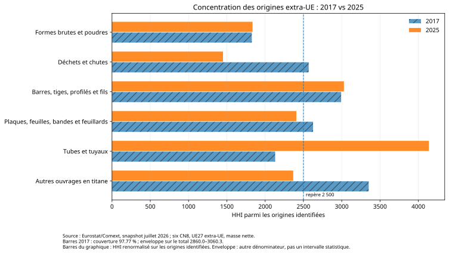
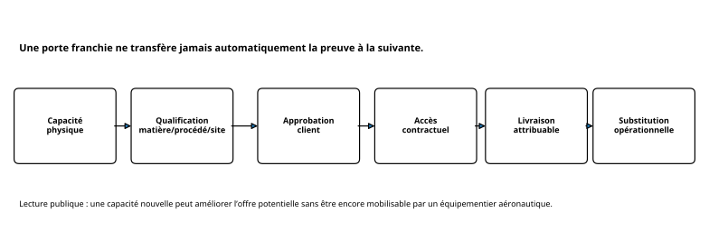

# ✈️ Case 01 - Titane et résilience aéronautique européenne

**Édition publiée — revues ouvertes.**

[](report.md)
[](methodology.md)
[](data/key_metrics.csv)
[](#hypothèses-concurrentes)

> **Question :** que montre la comparaison des importations européennes de titane en 2017 et en 2025, et quelles preuves supplémentaires faut-il pour apprécier la résilience aéronautique à l'horizon 2030 ?

Le cas combine des données commerciales Eurostat, des sources institutionnelles et des publications industrielles. Il montre surtout pourquoi **diversification commerciale, capacité industrielle, qualification aéronautique, approbation client et substitution réelle ne sont pas équivalentes**.

📄 [Rapport détaillé](report.md) · 📕 [PDF](report.pdf) · 🧪 [Méthodologie](methodology.md) · 📚 [Sources](sources.md) · 🔗 [Carte des preuves](evidence-map.md) · 🧾 [Provenance](provenance.csv) · 📊 [Métriques dérivées](data/key_metrics.csv)

## Comprendre le sujet

**La question en langage courant.** Si une source de titane devient indisponible, les industriels européens peuvent-ils réellement se fournir ailleurs ?

**L'idée à retenir.** Acheter dans davantage de pays peut aider. Pour fabriquer une pièce d'avion, il faut aussi la bonne matière, des procédés qualifiés, l'accord du client et des livraisons possibles. Les chiffres douaniers éclairent une partie de cette chaîne.

**Ce qui a été fait.** Le dossier compare des statistiques commerciales et des sources industrielles. Il sépare six catégories de produits pour éviter qu'une moyenne masque leurs différences.

**Statut.** La revue analytique reste [ouverte](../../README.md#trois-états-à-distinguer). Les tests auprès de débutants et la vérification avec un lecteur d’écran restent **à réaliser**. Les [contrôles techniques](../../publication/release-checklist.md) et les [contributions personnelles](../../AI_TRANSPARENCY.md) sont documentés séparément.

Les achats réels et les qualifications propres à chaque constructeur restent hors de ce que les données douanières démontrent.

**Pour découvrir les mots et la méthode : [guide de lecture](../../READING_GUIDE.md).**

---

## En deux minutes

- Les statistiques douanières montrent **où l'Union européenne importe du titane et à quel point ces origines sont concentrées**. Elles ne disent pas si un flux est de grade aéronautique, qualifié, approuvé par un client ou livrable sur un programme.
- Le résultat est **hétérogène** selon les formes : les tubes se concentrent fortement, les déchets et certains ouvrages se diversifient, les barres et les formes brutes restent globalement stables, les produits plats évoluent de façon mixte.
- Conséquence : **diversification commerciale ≠ résilience aéronautique**. Une capacité nouvelle n'est utile que si qualification, approbation client, accès contractuel et livraison convergent.

<p align="center">
  
</p>

## Chiffres clés

| Indicateur | Valeur |
|---|---|
| Catégories CN8 étudiées séparément | **6** |
| Années des mesures publiées | **2017 et 2025**, sans série annuelle intermédiaire |
| HHI des tubes et tuyaux | **2 130,6 → 4 137,9** |
| HHI des déchets et chutes | **2 568,5 → 1 449,4** |
| Premier partenaire des tubes en 2025 | **Chine, 60,23 %** des origines identifiées |
| Formes brutes / poudres : premier partenaire | **États-Unis 23,80 % (2017) → Kazakhstan 24,22 % (2025)**, HHI stable |
| Initiatives industrielles examinées | **11**, à des niveaux de maturité différents |

## Hypothèses concurrentes

| Hypothèse | Verdict | Confiance |
|---|---|---|
| H1 - exposition élevée persistante | partiellement soutenue | modérée |
| H2 - diversification effective | non concluante | faible |
| H3 - exposition déplacée | partiellement soutenue | faible |
| H4 - hétérogénéité par maillon / segment | partiellement soutenue | modérée |

Le casebook refuse de fabriquer un « score global » de résilience : il masquerait des différences de qualité de preuve et de périmètre.

## La chaîne qui compte


<p align="center">
  
</p>

## Établi / non démontré

| Établi par les sources publiques | Non démontré |
|---|---|
| comparaison des flux et HHI par code en 2017 et en 2025 | exposition exacte d'un programme ou d'un portefeuille réel |
| existence et statut de certaines initiatives | consommation exacte d'un équipementier |
| certaines démarches de qualification engagées | approbation de toutes les alternatives par chaque client |
| divergence entre catégories de produits | autonomie européenne ou effet causal d'un projet sur les flux |

## Scénarios 2030 et règles de décision

Trois scénarios qualitatifs (**SCE-01** diversification progressive mais qualification contrainte, **SCE-02** convergence capacité-qualification, **SCE-03** capacités inégales et substitution contrainte) servent à tester la robustesse des options. Ce ne sont pas des prévisions probabilistes.

1. **Surveiller n'est pas réduire physiquement le risque.**
2. **Préparer n'est pas activer.**
3. **Un trigger ouvre une revue, pas une action automatique.**
4. **L'OSINT ne dimensionne pas seul un stock.**

## Figures

| | |
|---|---|
| [Concentration HHI 2017-2025](figures/hhi_2017_2025.svg) | [Premier partenaire par code](figures/dominant_partner.svg) |
| [Portes de qualification](figures/qualification_gates.svg) | [Hypothèses concurrentes](figures/hypotheses.svg) |
| [Scénarios 2030](figures/scenarios_2030.svg) | |

## Contenu du dossier

```text
case-01-titanium/
├── README.md          # cette synthèse
├── report.md / .pdf   # rapport public complet (PDF reconstruit par la CI)
├── methodology.md     # méthode, périmètre, contrôles
├── sources.md         # sources sélectionnées et évaluation
├── evidence-map.md    # affirmation publique → preuve
├── provenance.csv     # lignée informationnelle de chaque affirmation
├── data/key_metrics.csv
└── figures/*.svg      # figures dérivées, régénérées par tools/build_publication.py
```

[← Retour au casebook](../../README.md)

## Reproduire les mesures

Le [parcours de reproduction](REPRODUCE.md) décrit les données, les étapes de calcul et ce que les chiffres permettent de conclure. La [carte des preuves](evidence-map.md) affiche les identifiants des affirmations.
