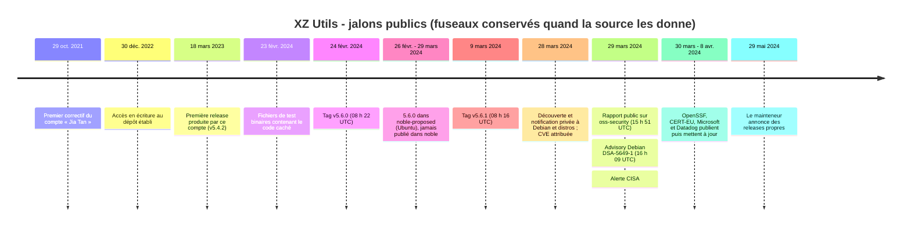

# 🔐 Case 04 - XZ Utils / CVE-2024-3094

**Statut : terminé et publié — Markdown et PDF. Révision analytique : 1er novembre 2026 ; clarification éditoriale : 13 novembre 2026.**

[](report.md)
[](sources.md)
[](report.md#2-méthode-de-collecte)
[](citations-ledger.json)

> **Question :** que permettent d'établir les sources publiques sur la chronologie de la compromission de XZ Utils, sa découverte, sa portée technique et la réponse de l'écosystème, sans dépasser les preuves disponibles concernant l'intention, l'identité ou l'attribution ?

Un cas de **compromission de la chaîne d'approvisionnement logicielle** traité en OSINT strictement passif : 21 sources publiques, faits et analyses séparés, contradictions conservées plutôt que lissées, fiabilité des sources et confiance analytique évaluées séparément.

📄 [Rapport](report.md) · [Télécharger le PDF](report.pdf) · 📚 [Sources](sources.md) · 🔗 [Carte des preuves](evidence-map.md) · 🧾 [Provenance](provenance.csv) · 🗂️ [Registre des preuves](evidence-register.md) · ✂️ [Extraits](source-extracts.md) · 🔏 [Ledger de citations](citations-ledger.json)

## Comprendre le sujet

**La question en langage courant.** Comment un logiciel diffusé largement a-t-il pu contenir un mécanisme malveillant, et que peut-on reconstituer à partir des sources publiques ?

**L'idée à retenir.** Les sources établissent la compromission de versions précises et un mécanisme soumis à certaines conditions techniques. Elles ne démontrent pas une exploitation réelle ni l'identité du responsable.

**Ce qui a été fait.** Le dossier reconstitue une chronologie, compare les situations des distributions Linux et conserve les contradictions entre sources. Il repose sur la lecture de documents ; le mécanisme malveillant n'a pas été exécuté par le projet.

**Statut.** Étude finalisée et publiée dans son périmètre, révisée sur le fond le 1er novembre 2026. L'identité réelle et l'exploitation effective restent non établies.

**Pour découvrir les mots et la méthode : [guide de lecture](../../READING_GUIDE.md).**

---

## En deux minutes

- Les sources convergent fortement : les versions **5.6.0 et 5.6.1** contenaient un code malveillant introduit via la **chaîne de publication / build**. **Confiance HIGH.**
- L'impact réel est **segmenté** : Debian (testing, unstable, experimental), Fedora Rawhide / 40 beta et openSUSE Tumbleweed sont concernés ; Debian stable, RHEL, SUSE Linux Enterprise et Leap ne le sont pas ; Arch Linux a reçu la version sans que le code soit compilé. « Tout Linux était compromis » est une simplification non soutenue.
- La capacité est une **exécution de commande pré-authentification via SSH, réservée au détenteur d'une clé Ed448** de l'attaquant : ce n'est pas un contournement ouvert à tous. **Confiance HIGH.** **Aucune exploitation réelle** n'est démontrée, et l'exploitation ne laisserait pas de trace dans les journaux usuels.
- La compromission n'a pas commencé en 2024 : elle s'inscrit dans **plus de deux ans de contributions** préalables (2021–2024), dont les jalons sont vérifiés sur l'archive de la liste xz-devel et l'historique Git. **Confiance HIGH.**
- **Ubuntu** n'a eu la version 5.6.0 que dans `noble-proposed` (26 février – 29 mars 2024) ; aucune version publiée d'Ubuntu n'est affectée. **Confiance HIGH.**
- **Aucune attribution** à une personne réelle, un groupe ou un État n'est établie ; la motivation reste inconnue. **Confiance LOW** pour toute attribution spécifique.

## Chronologie



## Hypothèses concurrentes

| Hypothèse | Évaluation | Confiance |
|---|---|---|
| **H1 - compromission délibérée de la chaîne de publication / build** | explication principale : tarballs compromis, versions successives, code obfusqué, conditions de build ciblées | **HIGH** pour l'insertion volontaire ; MEDIUM pour la reconstruction complète |
| H2 - compromission d'un compte ou d'un environnement de mainteneur sans connaissance de l'auteur | peu compatible avec plus de deux ans de contributions du même compte avant les releases compromises | LOW (abaissée) |
| H3 - opération organisée ou soutenue par un État | plausible, mais aucune source primaire n'identifie un acteur | LOW - non retenue |

## Contradictions conservées

| ID | Tension | Traitement |
|---|---|---|
| C-001 | 28 mars (Microsoft, Datadog) contre 29 mars (rapport public horodaté) | **réconciliée** : notification privée le 28, divulgation publique le 29 |
| C-002 | « Linux largement affecté » contre impact principalement pré-release | segmenter par distribution, canal et build |
| C-003 | contenu du dépôt contre contenu des tarballs | **résolue (documentaire)** : déclencheur M4 seulement dans les tarballs, charge cachée dans des fichiers de test du dépôt |
| C-004 | capacité technique contre exploitation observée | capacité ≠ exploitation |
| C-005 | motivation et identité | conflit de niveaux de preuve ; attribution LOW |
| C-006 | « accès pour des acteurs malveillants » contre accès réservé à la clé | différence de date et de précision ; accès réservé au détenteur de la clé |

## Établi / non démontré

| Établi par les sources publiques | Non démontré |
|---|---|
| versions 5.6.0 et 5.6.1 compromises (CVSS 10.0) | exploitation réelle, à quelque échelle que ce soit |
| mécanisme lié à la chaîne de publication / build et à liblzma | identité réelle derrière le pseudonyme |
| capacité réservée au détenteur d'une clé Ed448 | périmètre exact des distributions non documentées |
| périmètres Debian, Red Hat / Fedora, Arch Linux, openSUSE / SUSE, Ubuntu | exposition des machines ayant activé `noble-proposed` |
| préparation de plus de deux ans (jalons vérifiés sur sources primaires) | |
| séquence des releases et des advisories | attribution à un groupe ou à un État |

## Garanties de traçabilité

- Chaque citation de [`citations-ledger.json`](citations-ledger.json) figure **mot pour mot** dans [`source-extracts.md`](source-extracts.md), et chaque référence [n] du rapport pointe vers une source du ledger : c'est vérifié automatiquement par `tools/check_case.py` dans les tests du dépôt.
- Édition publique : seules les URL d'avatar des extraits S-008 / S-009 et une section interne ont été retirées.
- **Révision du 30 octobre 2026** : cinq sources ajoutées ([13] à [17]), chronologie 2021–2024, matrice d'exposition par distribution, C-001 et C-003 résolues, capacité technique requalifiée, H2 abaissée. Les faits d'origine sont conservés ; le détail figure en tête du [rapport](report.md#révision-du-2026-10-30).
- **Révision du 1er novembre 2026** : quatre sources primaires ajoutées ([18] à [21]) ; Ubuntu ajouté à la matrice d'exposition ; chronologie 2021–2024 vérifiée sur l'archive xz-devel et les métadonnées Git (dépôt cloné sans aucun contenu de fichier) ; heures des tags v5.6.0 et v5.6.1 normalisées en UTC. Le détail figure en tête du [rapport](report.md#révision-du-2026-11-01).
- Aucune tentative d'identification des personnes derrière les pseudonymes, aucun scan, aucune interaction avec des systèmes réels.

## Contenu du dossier

```text
case-04-xz-utils/
├── README.md               # cette synthèse
├── report.md / report.pdf  # rapport complet, en ligne et imprimable
├── sources.md              # 21 sources, type, fiabilité, dépendances
├── evidence-map.md         # affirmation publique → preuve
├── provenance.csv          # lignée informationnelle de chaque affirmation
├── evidence-register.md    # registre E-001 à E-018, contradictions C-001 à C-006
├── source-extracts.md      # extraits courts vérifiables
└── citations-ledger.json   # ledger des citations (URL, date d'accès, extrait)
```

[← Retour au casebook](../../README.md)
